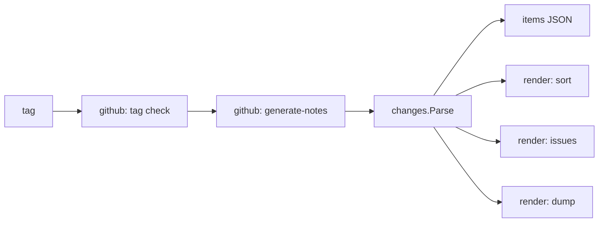

`gh release-changes` reads GitHub's generated notes for a release and renders the same set of changes for each
audience: a grouped "What's Changed" list, an issue list for the release ticket, and an issue dump for an LLM
to write release notes from. Every output is derived from the same parsed items, so they can never disagree.

Structure, conventions and library choices deliberately mirror
[`specsnl/labelsync`](https://github.com/specsnl/labelsync). Full rationale:
[design.md](https://github.com/specsnl/gh-release-changes/blob/main/docs/design.md).

## Package structure

```text
gh-release-changes/
├── main.go                       # cmd.Execute(), exit.Of, the single error print
└── internal/
    ├── releasechanges/           # errors.go: sentinels + KindOf()
    ├── cmd/                      # one file per Cobra command; app.go holds App, tag.go the tag picker
    ├── github/                   # go-gh clients: tag check, generate-notes, tags, issue details
    ├── changes/                  # Item/Release, Parse(), grouping and sorting, dump's Details — pure
    ├── render/                   # sort Markdown, issue list, dump Markdown — pure
    ├── semver/                   # tag ordering for the picker, the previous final release — pure
    └── util/
        ├── exit/                 # exit codes, exit.Err, exit.Of
        └── output/               # Writer for stderr diagnostics, slog setup, TTY detection
```

| Package                   | Status                                                                                          |
|---------------------------|-------------------------------------------------------------------------------------------------|
| `internal/releasechanges` | Built — see [Error Handling]()                                 |
| `internal/util/exit`      | Built — see [Output & Exit Codes]()                                    |
| `internal/util/output`    | Built — see [Output & Exit Codes]()                                    |
| `internal/cmd`            | `App`, the root and its persistent flags, `items`, `sort`, `issues`, `dump`, `version`, `notes` |
| `internal/changes`        | Built — see [Parser]()                                                 |
| `internal/github`         | Notes, tags, issue details — see [GitHub Client]()                     |
| `internal/render`         | `Sort`, `Issues`, `Dump` — see [Commands](#commands)                                            |
| `internal/semver`         | `Sort`, `PreviousFinal` — see [The tag](#the-tag) and [The base](#the-base)                     |

### Why `changes`, `render` and `semver` are isolated

None of them imports `internal/github`. They take plain structs (or a body string) and return plain structs or
text, so the parser rules, grouping, ordering and reference formatting are testable with table-driven stdlib
tests and golden files, with no HTTP mocking — and a future "render from a saved `items` file" mode is a thin
deserialisation shell rather than a refactor.

## Data flow



Only `internal/github` talks to GitHub, through go-gh, so authentication and GHES hosts are gh's.

## The tag

Every command that takes a tag takes it as an optional argument, resolved by `App.resolveTag` in
`internal/cmd/tag.go` before anything else is requested:

1. A tag argument is used as given.
2. Without one, the guard: unless stdin and stdout are both terminals (`output.IsTTY`), the run fails with
   `ErrInteractiveRequired` and a hint to pass the tag. A command checks its own flags first, so a bad flag is
   still the error reported.
3. The `TagSource` lists the repository's tags, `semver.Sort` orders them, and the `TagPicker` asks.

`semver.Sort` orders semantic versions (an optional `v`, then Semantic Versioning 2.0.0) newest first,
pre-releases included by the specification's precedence rules, then every other tag in reverse lexical order;
ties go by name, so the order is total. The real picker is a `charm.land/huh/v2` `Select` with type-to-filter
and 10 visible tags, drawn on stderr because stdout is the product. `App.PickTag` is the test seam, as in
labelsync: a test that supplies a picker also declares the run interactive, since a terminal cannot be faked
portably.

## The base

`App.previousTag` in `internal/cmd/release.go` decides what the notes are generated against, for every command
that generates them: `--previous-tag` as given, or `""` to let GitHub choose. With `--since-final` it lists the
repository's tags through the `TagSource` and takes `semver.PreviousFinal(tags, tag)`: the newest semantic
version without pre-release identifiers whose precedence is below the tag's, skipping every tag that is not a
semantic version. Without one — the first release, or a non-semver tag — GitHub chooses after all and an info
line on stderr says so; a failure to list the tags fails the run. Cobra rejects `--previous-tag` together with
`--since-final` (`MarkFlagsMutuallyExclusive`) before any command runs.

## Commands

Every rendering command starts with the same step, `App.loadRelease` in `internal/cmd/release.go`: create the
`NotesSource`, generate the notes against `App.previousTag`, `changes.Parse` the body, and assemble a
`changes.Release` with the resolved repository and the previous tag. Unclassified items are warned about there,
once, on stderr. A command then only turns the `Release` into its product on stdout:

| Command       | File            | Product                                                                              |
|---------------|-----------------|--------------------------------------------------------------------------------------|
| `items`       | `items.go`      | `changes.Release` marshalled as indented JSON                                        |
| `sort`        | `sort.go`       | `render.Sort`: the grouped "What's Changed" Markdown                                 |
| `issues`      | `issues.go`     | `render.Issues`, with the `render.IssueRefs` and `render.IssueList` its flags choose |
| `dump`        | `dump.go`       | `render.Dump` over the `Release` and the `changes.Details` a `DetailsSource` fetched |
| `check-notes` | `checknotes.go` | `render.CheckNotes` over the `changes.Coverage` of the notes file                    |

`dump` makes a second request after the notes: it asks the `DetailsSource` for every issue the items reference
(`changes.ReferencedIssues`) and for the features and fixes without one (`changes.Untracked`). `Untracked`
is defined on `changes.Issueless` — no issue, no dependency update — which is what `issues --unlinked` lists,
so the two commands cannot drift apart on what "without an issue" means; `dump` narrows it to features and
fixes. An issue's linked pull requests are only known once it is read, so the release's pull requests an issue
does not link (`changes.UnlinkedPullRequests`) are asked for in a third request, made only when there are any,
and merged in (`Details.Merge`). What GitHub could not read is rendered as a note in place and warned about on stderr after
the product is written; the command then returns a silent `*exit.Err{Code: exit.Skipped}`, so the run exits `4`.
A failure of either details request as a whole fails the run before anything is printed.

`check-notes` makes no request beyond the notes. It reads the file (or stdin for `-`) after the tag is resolved
and before the notes are generated, so an unreadable file fails without a call to GitHub. `changes.NoteRefs`
extracts the references from the text, resolving a bare `#N` against `--relative-to`, and `changes.CheckNotes`
compares them with `changes.ReferencedIssues` in the `--scope-issue-repo` repository and with the release's pull
requests in the source repository. Both are pure, so the extraction rules are table tests. A difference is
written to stdout and the command returns a silent `*exit.Err{Code: exit.Mismatch}`, so the run exits `2`.
`issues` and `check-notes` share `checkIssueRepoFlags` and `issueRefs`, so the two flags default and validate
the same way in both.

`issues --titles` makes one more request after the notes, and only when an issue is referenced: it asks the
`TitleSource` for the titles of `changes.ReferencedIssues` in the `--scope-issue-repo` repository, and hands them
to `render.Issues` as a plain `map[int]string`. A title that could not be read is left out of the map, so its
issue keeps its bare reference; it is warned about after the product is written and the run exits `4`, as for
`dump`.

### Renamed flags

A flag that shipped under another name keeps that name as a hidden alias until it is removed:
`internal/cmd/renamed.go` lists each old name with its replacement. `addRenamedFlags` defines the old name over
the same `pflag.Value` as the new one, so a command only ever reads the new flag, and marks the two mutually
exclusive. `App.resolveFlags` calls `warnRenamedFlags`, which warns through `output.Writer` for every old name a
run was given. pflag's own `MarkDeprecated` is not used: its notice goes to the flag set's output rather than
the `Writer`. Today that is `--issue-repo` (now `--scope-issue-repo`) and `--ticket-repo` (now `--relative-to`),
due for removal in [#44](https://github.com/specsnl/gh-release-changes/issues/44).

Command tests drive the whole tree with a fake `NotesSource` answering with the parser's fixtures, and compare
stdout with golden files under `internal/cmd/testdata/<command>/`; `go test ./internal/cmd -update` rewrites
them. A command that prints a renderer's output unchanged is compared with that renderer's golden files instead.

`internal/render` holds the Markdown renderers. Like `internal/changes` it is pure — plain items in, text out —
and golden-tested over the same captured bodies, under `internal/render/testdata/<renderer>/`. A renderer never
reorders its input; it takes the display order from `changes.Sections`, and the issues of a group from
`Section.Issues`, which sorts and deduplicates them. `render.Dump` quotes every description and comment in a
tilde fence one longer than the longest run of `~` in it (at least three): GitHub's Markdown brings its own
headings and fences, and unquoted they would end up in the dump's outline, under the wrong issue.
`render.Dump` is golden-tested over a small release built for it, in `internal/render/testdata/dump/` — the
generated notes and the details GitHub answered — which the `dump` command test reuses through a fake
`DetailsSource`.
