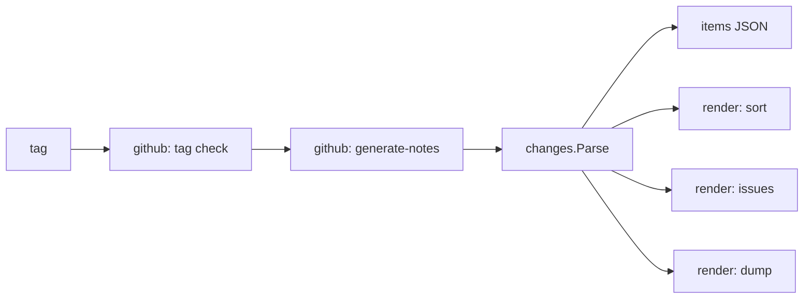

`gh release-changes` reads GitHub's generated notes for a release and renders the same set of changes for each
audience: a grouped "What's Changed" list, an issue list for the release ticket, and an issue dump for an LLM
to write release notes from. Every output is derived from the same parsed items, so they can never disagree.

Structure, conventions and library choices deliberately mirror
[`specsnl/labelsync`](https://github.com/specsnl/labelsync). Full rationale:
[design.md](https://github.com/specsnl/gh-release-changes/blob/main/docs/design.md).

## Package structure

```text
gh-release-changes/
├── main.go                       # cmd.Execute(), exit.Of, the single error print
└── internal/
    ├── releasechanges/           # errors.go: sentinels + KindOf()
    ├── cmd/                      # one file per Cobra command; app.go holds App and the persistent flags
    ├── github/                   # go-gh clients: tag check, generate-notes (tags, issue details to come)
    ├── changes/                  # Item/Release, Parse(), grouping and sorting — pure
    ├── render/                   # sort Markdown, issue list (dump Markdown to come) — pure
    ├── semver/                   # (v0.2) tag ordering for the picker — pure
    └── util/
        ├── exit/                 # exit codes, exit.Err, exit.Of
        └── output/               # Writer for stderr diagnostics, slog setup, TTY detection
```

| Package                   | Status                                                                                  |
|---------------------------|-----------------------------------------------------------------------------------------|
| `internal/releasechanges` | Built — see [Error Handling]()                         |
| `internal/util/exit`      | Built — see [Output & Exit Codes]()                            |
| `internal/util/output`    | Built — see [Output & Exit Codes]()                            |
| `internal/cmd`            | `App`, the root and its persistent flags, `items`, `sort`, `issues`, `version`, `notes` |
| `internal/changes`        | Built — see [Parser]()                                         |
| `internal/github`         | Notes — see [GitHub Client]()                                  |
| `internal/render`         | `Sort`, `Issues` — see [Commands](#commands)                                            |

### Why `changes`, `render` and `semver` are isolated

None of them imports `internal/github`. They take plain structs (or a body string) and return plain structs or
text, so the parser rules, grouping, ordering and reference formatting are testable with table-driven stdlib
tests and golden files, with no HTTP mocking — and a future "render from a saved `items` file" mode is a thin
deserialisation shell rather than a refactor.

## Data flow



Only `internal/github` talks to GitHub, through go-gh, so authentication and GHES hosts are gh's.

## Commands

Every rendering command starts with the same step, `App.loadRelease` in `internal/cmd/release.go`: create the
`NotesSource`, generate the notes, `changes.Parse` the body, and assemble a `changes.Release` with the resolved
repository and the previous tag. Unclassified items are warned about there, once, on stderr. A command then only
turns the `Release` into its product on stdout:

| Command  | File        | Product                                                                                      |
|----------|-------------|----------------------------------------------------------------------------------------------|
| `items`  | `items.go`  | `changes.Release` marshalled as indented JSON                                                |
| `sort`   | `sort.go`   | `render.Sort`: the grouped "What's Changed" Markdown                                         |
| `issues` | `issues.go` | `render.Issues`, with the reference form from `--issue-repo`, `--ticket-repo`, `--full-refs` |

Command tests drive the whole tree with a fake `NotesSource` answering with the parser's fixtures, and compare
stdout with golden files under `internal/cmd/testdata/<command>/`; `go test ./internal/cmd -update` rewrites
them. A command that prints a renderer's output unchanged is compared with that renderer's golden files instead.

`internal/render` holds the Markdown renderers. Like `internal/changes` it is pure — plain items in, text out —
and golden-tested over the same captured bodies, under `internal/render/testdata/<renderer>/`. A renderer never
reorders its input; it takes the display order from `changes.Sections`, and the issues of a group from
`Section.Issues`, which sorts and deduplicates them.
