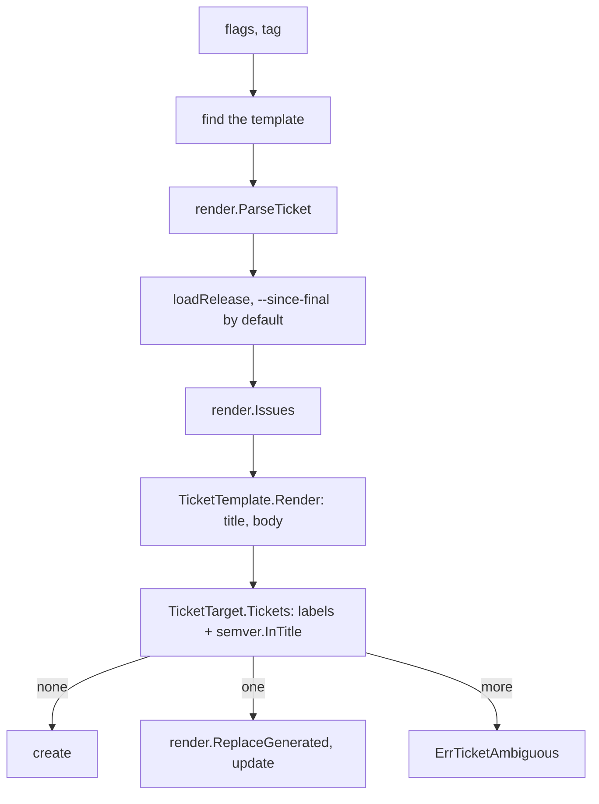

`ticket` is the first command that writes to GitHub, and `ticket init` the first that writes local files. Every
other command reads a release and prints. How to use them is on the
[usage page](); this page is how they are built.

## Where the parts live

| Package             | Holds                                                                                                        |
|---------------------|--------------------------------------------------------------------------------------------------------------|
| `internal/cmd`      | `ticket.go`: the lookup order, the flow, the confirmation; `ticketinit.go`: `ticket init`                    |
| `internal/checkout` | `Root`: the repository root of a directory; `ReadTemplates`: a template set from disk                        |
| `internal/render`   | `ParseTicket`, `TicketTemplate.Render`, `ReplaceGenerated`, `TicketFuncs`, and the embedded templates — pure |
| `internal/github`   | `TicketTemplates` through the contents API; `Tickets`, `CreateTicket`, `UpdateTicket` on the issues API      |
| `internal/semver`   | `Release` (`v1.4.0-rc.2` → `1.4.0`) and `InTitle`, which find the ticket again — pure                        |

`internal/checkout` is a package of its own so root discovery and local reads are tested in a temp directory,
without GitHub. `internal/render` stays pure: it gets the template files as a `map[string]string` and the data
as a `TicketData`, and returns text. The built-in default (`templates/default/`) and the starter set
`ticket init` writes (`templates/init/`) are embedded in it with `embed`.

## The flow

The template is found and parsed before the release is read, so a template that does not parse fails without
generating notes. `ticket` turns `--since-final` on unless `--previous-tag` or `--since-final` was given, by
setting `App.SinceFinal` when neither flag is `Changed`. `--link closing` stays opt-in, as for every command:
`--link` has no spelling to turn it off again, and without it the ticket costs no GraphQL request.

## The template set

`render.ParseTicket(files, entry)` parses every file into one `text/template` set, named by file name, so any
file can `{{ template }}` any other. The function map is Sprout's registries without `env`, `filesystem`,
`backward` and the deprecated `regexp` (Sprout registers `regex` or `regexp`, never both), plus `include`, which
executes a named template into a string. `include` closes over the set and counts its depth, so a part that
includes itself fails instead of overflowing the stack. Sprout's logger is `slog.Default()`, the debug-only
channel; its own default would write to stdout, the product.

Front matter is YAML (`go.yaml.in/yaml/v3`, with `KnownFields`), cut from the entry point before it is parsed.
Its lines are replaced by blank lines and a `{{- "" -}}` on the closing line, which trims them and the
whitespace after it, so the body renders without them and a parse error still names its line in the file. Front
matter was chosen over a sibling config file: it travels with the template through every source — a local file,
the contents API, the embedded default — with no second lookup.

`TicketTemplate.Render` parses the title into the same set, executes it and the entry point with
`missingkey=error`, folds the title onto one line, and checks the markers: none wraps the whole body in them,
one pair in order is kept, anything else is `ErrTemplate`. `ReplaceGenerated` puts that block in place of the
existing ticket's, from the first start marker to the first end marker after it, and appends it when there is
no pair. The index arithmetic leaves `\r\n` from GitHub's web editor alone.

`TestInitTemplate_UsesEveryField` reflects over `TicketData` and walks the parse trees of the init templates for
field nodes, so a field added to the data without a use in the starter template fails the build.

## Finding the template

`App.findTicketTemplate` tries the sources in order and returns the files, the entry point's name and a label
for the `info: template:` line:

1. `--template`: `checkout.ReadTemplates(path)` reads the file and every `*.tmpl` next to it.
2. Without `-R`: `checkout.Root` from the working directory, then `ReadTemplates` of
   `.github/release-changes/ticket.md.tmpl` there. A missing root or file (`fs.ErrNotExist`) moves on; any
   other read error fails with `ErrTemplate`.
3. `TemplateSource.TicketTemplates`: one contents-API listing of the directory on the default branch, then one
   request per `*.tmpl` file. A 404 on the listing is no template.
4. `render.DefaultTicketFiles()`.

`checkout.Root` runs `git rev-parse --show-toplevel` in the directory, falls back to walking up for a `.git`
(directory or file) or `.jj` with `os.Lstat`, and then, only when `GITHUB_ACTIONS` is `true`, to
`$GITHUB_WORKSPACE`. Nothing found is `ErrNoRepoRoot`.

## Writing

`TicketTarget` is the boundary, created by `App.NewTicketTarget` for `--create-in`, or `-R`:

- `Tickets` lists `GET /repos/{owner}/{repo}/issues?labels=…&state=all`, 100 per page until a short page, and
  drops pull requests. `semver.InTitle` keeps those whose title names `semver.Release(tag)` as a whole version:
  no digit or dot before it, and no digit, or dot and digit, after it.
- `CreateTicket` is `POST /repos/{owner}/{repo}/issues` with the title, body and labels.
- `UpdateTicket` is `PATCH /repos/{owner}/{repo}/issues/{number}` with the title and body only: a `labels`
  field would replace the issue's labels, and the issue was found by them.

A ticket whose title and body would not change is not written. Before a write `App.writeTicket` shows the
ticket on stderr and asks through `App.Confirm`, a seam like `App.PickTag`: nil is a `huh` Confirm, and a test
that sets it declares the run interactive. Without a terminal on stdin and stdout and without `--yes`, the run
fails with `ErrInteractiveRequired` before it writes. The URL goes to stdout; `--dry-run` prints the title,
labels and body there instead.

`ErrForbidden` carries no permission in its own message: `mapErrorFor` adds the one the call needs —
Contents: write for the notes, Issues: write for the ticket, Contents: read for the template — so a 403 keeps
the `forbidden` kind and still says what to grant.

## `ticket init`

Writes `render.InitTicketFiles()` to `--dir`, or `.github/release-changes/` under `checkout.Root` of the working
directory. Without `--force` every target is checked with `os.Lstat` first, so an existing file fails the run
with `ErrTemplateExists` before anything is written. `--stdout` prints the files with a `==> name <==` header
each and writes nothing.
