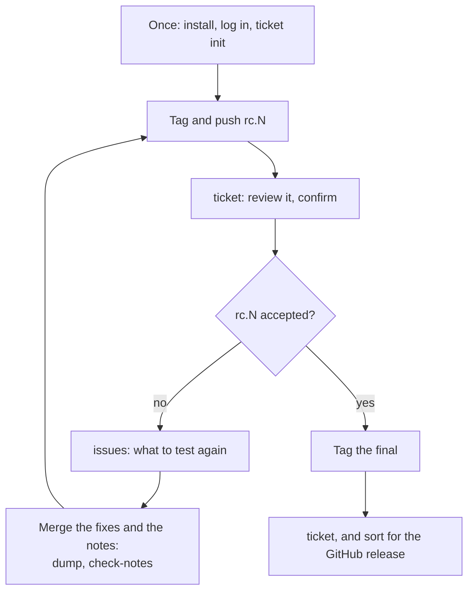

A release run by hand, without CI: the release manager tags the candidates and runs every command from a
terminal in the repository's checkout. A terminal is also where the tool asks: it offers the tags to pick from,
and shows the ticket before writing it.



The order and the range of every step are explained in [the release flow]();
this guide is about running them by hand.

## Once per machine

```shell
gh extension install specsnl/gh-release-changes
gh auth status
gh release-changes version
```

Your own account does the work, so it needs **Write** access to the repository: generating the release notes
takes Contents: write, even though nothing is created, and the ticket takes Issues: write. With read access
only, a run fails with `error: forbidden: …`. `gh extension upgrade gh-release-changes`
brings the tool up to date.

## Once per repository

Write the ticket template, adjust it, and try it on an existing tag before committing it:

```shell
gh release-changes ticket init
$EDITOR .github/release-changes/ticket.md.tmpl
gh release-changes ticket v1.3.0 --var environment=acc --dry-run
```

The run takes the template from your checkout, uncommitted edits included, so `--dry-run` shows the edit at once.
Commit the template when it is right. Add the label exclude for back-merges to `.github/release.yml` while
you are at it, as described in [the release flow]().

## Short commands

The flags of a release are the same every time. `gh alias` keeps them in one place; the arguments after an
alias are appended to it:

```shell
gh alias set rc-ticket 'release-changes --link closing ticket'
gh alias set rc-retest 'release-changes --link closing issues --titles'
gh alias set rc-dump 'release-changes --since-final --link closing dump'
gh alias set rc-check 'release-changes --since-final --link closing check-notes'
```

So `gh rc-ticket v1.4.0-rc.2 --var environment=acc` runs
`gh release-changes --link closing ticket v1.4.0-rc.2 --var environment=acc`. Aliases are stored in your own gh
configuration: write them in the repository's release instructions so the next release manager uses the same
flags.

## Pick the tag, or pass it

Leave the tag out on a terminal, and the tool offers the repository's tags: newest first, release candidates
included. Type to filter, Enter to pick, Ctrl+C to cancel.

```shell
gh rc-ticket --var environment=acc
```

The picker is shown only when both the input and the output are a terminal. Once the output goes to a file, a
pipe or the clipboard, pass the tag: without it the run fails with `error: operation requires an interactive
terminal` and exit code `1`.

## Release candidate: tag, ticket

```shell
git switch --create release/v1.4.0 origin/main
git tag --annotate v1.4.0-rc.1 --message "Release candidate v1.4.0-rc.1"
git push origin release/v1.4.0 v1.4.0-rc.1
gh rc-ticket v1.4.0-rc.1 --var environment=acc
```

The ticket is shown on stderr before anything is written, and the tool asks:

```text
title: Release 1.4.0-rc.1
labels: release

# Release 1.4.0-rc.1 of example-org/app

<!-- gh-release-changes:start -->
…
<!-- gh-release-changes:end -->
…

Create a new issue in example-org/app?
```

Yes writes it, reports `info: created example-org/app#120` on stderr and prints the URL on stdout. No leaves
it, with `info: nothing written`. For `rc.2` the question is `Update example-org/app#120?`, and a ticket that
would not change is not asked about at all: `info: example-org/app#120 is up to date`.

## Tell QA what to test again

For `rc.2`, GitHub's own range is the delta since `rc.1`. With the titles it reads well outside GitHub — in a
mail or a deploy request — and straight into the clipboard:

```shell
gh rc-retest v1.4.0-rc.2 | pbcopy
```

```markdown
## Issues

### Bug fixes

* #14 The export stops at 1000 rows
```

`pbcopy` is macOS; on Linux use `wl-copy` (Wayland) or `xclip -selection clipboard` (X11), on Windows
`clip.exe`. Add `--full-refs` when the text goes to another GitHub repository, so `#14` still points at the
right issue.

## The release notes

Read the release, write the notes — by hand or [with an agent]() —
and check them before you push them:

```shell
gh rc-dump v1.4.0-rc.2 > /tmp/dump-1.4.0.md
$EDITOR docs/release-notes/1.4.0.md
gh rc-check v1.4.0-rc.2 --file docs/release-notes/1.4.0.md; echo "exit $?"
```

Exit `0` means the notes cover the release, `2` that they do not — the report says what is missing and what is
outside the release. Notes that live somewhere else, such as a document or a pull request comment, can be checked
from the clipboard:

```shell
pbpaste | gh rc-check v1.4.0-rc.2 --file -
```

Check against the newest candidate, and again when another one is tagged: what is merged after the newest
candidate is in no tag yet.

## The final: tag, ticket, GitHub release

```shell
git tag --annotate v1.4.0 --message "Release v1.4.0" "v1.4.0-rc.3^{commit}"
git push origin v1.4.0
gh rc-ticket v1.4.0 --var environment=prod
gh release-changes sort v1.4.0 > /tmp/release-1.4.0.md
gh release create v1.4.0 --verify-tag --title v1.4.0 --notes-file /tmp/release-1.4.0.md --draft
```

The file lets you read and edit the list before it is published; `--draft` lets you look at it on GitHub first.
Publish it there, or with `gh release edit v1.4.0 --draft=false`.

## When something is off

| Symptom                                  | What to do                                                                               |
|------------------------------------------|------------------------------------------------------------------------------------------|
| The list is not what you expected        | `--debug` logs the tag GitHub compared with, and the API error behind a failure          |
| An item is in the wrong group            | `gh release-changes notes <tag>` prints GitHub's own body, before the tool reads it      |
| The ticket renders from an old template  | It comes from your checkout: switch to the branch the template is on, or pull            |
| You are not in the repository's checkout | `-R OWNER/REPO`; the template then comes from the repository's default branch            |
| `error: … interactive terminal`          | The output is not a terminal: pass the tag, and `--yes` to write a ticket without asking |
| `ticket` finds more than one issue       | Two issues carry the label and the version: remove the label from the one that is not it |

Every error is one `error: …` line on stderr, and the exit code says what kind of outcome it was: see
[Exit codes]().
