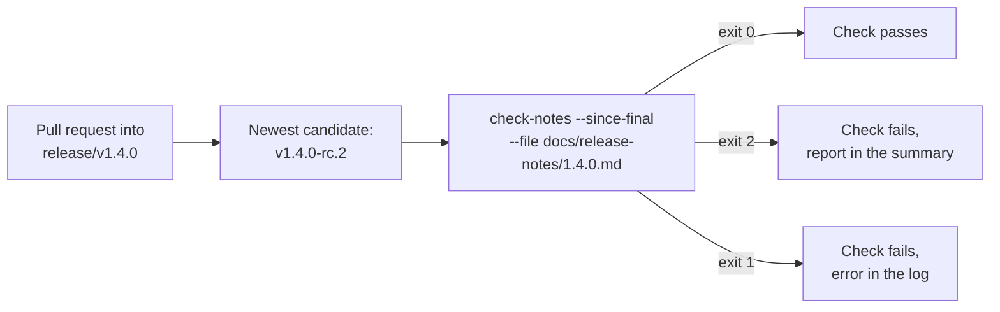

Run [`check-notes`]() on every pull request that changes the
release notes on a release branch, so notes that miss an issue of the release, or mention one outside it, do
not get merged.



## Which tag to check against

The final does not exist yet while the notes are written: it is tagged on the accepted candidate, after the
notes are merged. So the check runs against the newest candidate of the release, with `--since-final`, which
gives the candidate the range of the final: every issue since the previous final release.

A change merged into the release branch after the newest candidate is in no tag yet, so the check cannot see
it. Tag a candidate before the notes are finished, and run the check again when one is tagged.

## The workflow

`.github/workflows/release-notes.yml`, for notes in one file per release, `docs/release-notes/<version>.md`, on
release branches named `release/v<version>`:

```yaml
name: Release notes

on:
  pull_request:
    branches:
      - "release/**"
    paths:
      - "docs/release-notes/**"

permissions:
  contents: write # generate-notes needs it, though it creates nothing
  issues: read # the issues the notes are checked against
  pull-requests: read # --link closing reads what the pull requests close

jobs:
  check-notes:
    runs-on: ubuntu-latest
    defaults:
      run:
        shell: bash
    env:
      GH_TOKEN: ${{ github.token }}
      BASE_REF: ${{ github.base_ref }}
    steps:
      - uses: actions/checkout@v7

      - name: Install gh-release-changes
        run: gh extension install specsnl/gh-release-changes --pin v0.4.0

      - name: Check the notes against the release
        run: |
          version="${BASE_REF#release/}"

          tag=$(git ls-remote --tags --refs origin "refs/tags/${version}-rc.*" \
            | sed 's|.*refs/tags/||' | sort --version-sort | tail --lines 1)
          if [[ -z "$tag" ]]; then
            echo "::error::No release candidate of $version is tagged yet"
            exit 1
          fi

          code=0
          gh release-changes --since-final --link closing \
            check-notes "$tag" --file "docs/release-notes/${version#v}.md" > report.md || code=$?

          tee --append "$GITHUB_STEP_SUMMARY" < report.md

          if (( code & 2 )); then
            echo "::error::The notes and $tag disagree; see the job summary"
            exit 1
          fi
          exit "$code"
```

- **The release branch names the version.** `release/v1.4.0` gives `v1.4.0`, the candidates `v1.4.0-rc.*`,
  and the notes `docs/release-notes/1.4.0.md`. Adjust the three to your names.
- **`sort --version-sort`** puts `rc.10` after `rc.9`.
- **`|| code=$?`** keeps the exit code: `2` is an answer, not an error, and the report on stdout still has to
  reach the summary. Bit `2` fails the check with that report; `1` fails it with the error in the log.
- **`--link closing`** matches what the ticket lists, as
  [the release flow]() explains. Use the
  same flags as the workflow or skill that writes the ticket and the notes.
- **Pull requests from forks** get a read-only `GITHUB_TOKEN`, and `generate-notes` fails with `forbidden`.
  Notes pull requests into a release branch come from a branch in the repository.

## Notes in one growing file

`check-notes` reads every reference in the file. A `CHANGELOG.md` that holds every release mentions the issues
of the earlier ones too, which are outside this release. Give the check only this release's section, on stdin
with `--file -`. For sections headed `## 1.4.0`:

```shell
awk -v version="${version#v}" '/^## / { this = ($2 == version) } this' CHANGELOG.md \
  | gh release-changes --since-final --link closing check-notes "$tag" --file - > report.md || code=$?
```

## Notes published elsewhere

A bare `#N` is read as an issue of the source repository. When the notes are published in another repository
— a public mirror, a documentation repository — `#N` there means an issue of that one. Pass
`--relative-to OWNER/REPO` so the check reads them as GitHub will, and writes its report the same way.
