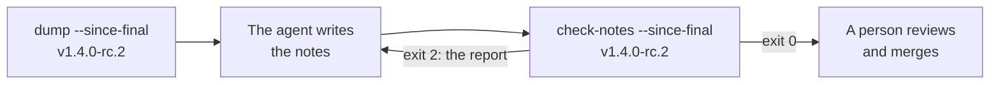

Release notes are written for people who use the product, and that takes judgement: what matters, in which
words. An agent can draft them, but only from the right input, and only with a check it cannot argue with.
`gh release-changes` gives it both: `dump` is the input, `check-notes` is the check.



## 1. The input: `dump`

```shell
gh release-changes --since-final --link closing dump v1.4.0-rc.2 > dump.md
```

`dump` writes every issue of the release as one Markdown document: title, labels, description, comments, and
the pull requests that closed it. Features and fixes without an issue follow with their pull request's
description. That is what the notes are written from: what was asked for and what was discussed, not the
commit titles.

- `--since-final` makes it the whole release, on a candidate. On the final itself it is GitHub's range already.
- `--link closing` brings in the issues a pull request closes without naming them in its title. Pass it to
  `check-notes` as well, or the check disagrees with the input.
- A linked pull request marked `In this release: no` is an earlier attempt, or one still open. It is context,
  not a change of this release.
- Exit `4` means an issue could not be read: it is named on stderr, and noted in place in the dump. Write the
  notes anyway, but say which issue is missing from the input.

## 2. The check: `check-notes`

```shell
gh release-changes --since-final --link closing check-notes v1.4.0-rc.2 --file docs/release-notes/1.4.0.md
```

```markdown
## Notes check

### Issues missing from the notes

* #14

### References outside the release

* #9
```

The check reads every `#N`, `OWNER/REPO#N` and issue or pull request URL in the notes, and compares them with
the issues of the release. Exit `0` means they agree; exit `2` comes with the report above, which is exactly
what the agent needs to fix. So the notes refer to every issue they describe, and a change without an issue by
its pull request.

When the notes are published in another repository than the source, a bare `#N` means an issue there: pass
`--relative-to OWNER/REPO` so the check reads them as GitHub will.

## A skill for the loop

The steps fit an agent skill. For Claude Code that is `.claude/skills/release-notes/SKILL.md` in the
repository; other agents take the same instructions in their own format.

````markdown
---
name: release-notes
description: Write the release notes of a release from its issues, and check them with gh release-changes.
  Use when asked to write or update the release notes for a version or a tag.
---

# Release notes

1. Find the newest release candidate of the version, `vX.Y.Z-rc.N`: `git tag --list 'vX.Y.Z-rc.*' --sort=-v:refname`.
   Use the final tag `vX.Y.Z` instead when it exists. Always pass the tag: there is no terminal to pick one.
2. Read the release:
   `gh release-changes --since-final --link closing dump <tag> > /tmp/dump.md`.
   Exit 4 means an issue could not be read; tell the user which, and go on.
3. Write `docs/release-notes/X.Y.Z.md` in the style of the earlier files there. Write for users, not
   developers: what they can do now, what was fixed. Group by part of the product. Refer to every issue you
   describe as `#N`, and to a change without an issue by its pull request.
   Leave out pull requests marked `In this release: no`.
4. Check the notes:
   `gh release-changes --since-final --link closing check-notes <tag> --file docs/release-notes/X.Y.Z.md`.
   - Exit 0: done.
   - Exit 2: the report on stdout lists the issues missing from the notes and the references outside the
     release. Add the missing ones where they belong — read them in the dump — and remove or correct the
     others. Check again.
   - Exit 1: stop, and show the user the error.
5. Show the user the notes and the final check. Do not commit or open a pull request unless asked.
````

- The loop ends on an exit code, not on the agent's own judgement that the notes are complete.
- A person still reads the notes: the check proves every issue is mentioned, not that it is described well.
- The notes pull request can run the same check in CI, so a later edit by hand cannot break it unnoticed:
  see [the notes check in CI]().

## Structured input instead

`dump` is written for reading. For a skill that classifies or groups the changes itself, `items` gives the same
release as JSON — every pull request with its type, scopes, issues and group — described in
[the `items` JSON]():

```shell
gh release-changes --since-final --link closing items v1.4.0-rc.2 | jq '.items[] | {pr, group, issues}'
```
