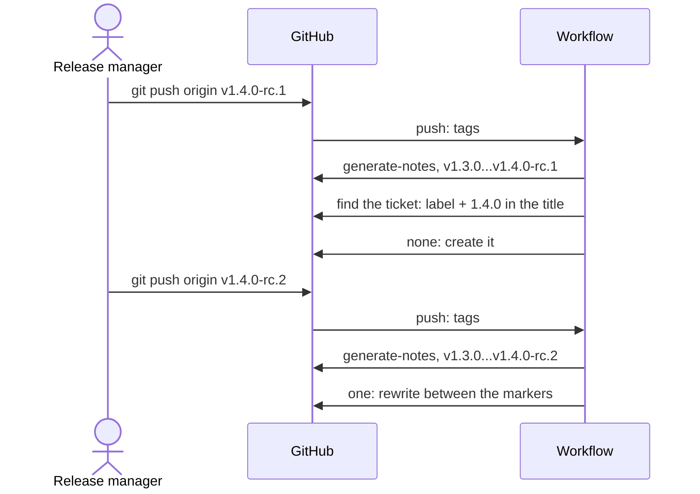

Run [`ticket`]() from a workflow on every pushed release tag, so the release
ticket is created at `rc.1` and kept up to date for every candidate after it, without anyone running it.



## The workflow

`.github/workflows/release-ticket.yml`:

```yaml
name: Release ticket

on:
  push:
    tags:
      - "v*"
  workflow_dispatch:
    inputs:
      tag:
        description: The tag to render the ticket for
        required: true
      dry_run:
        description: Print the ticket instead of writing it
        type: boolean
        default: true

permissions:
  contents: write # generate-notes needs it, though it creates nothing
  issues: write # create and update the ticket

# One ticket per release: two tags pushed at once must not both create one.
concurrency:
  group: release-ticket
  cancel-in-progress: false

jobs:
  ticket:
    runs-on: ubuntu-latest
    defaults:
      run:
        shell: bash
    env:
      GH_TOKEN: ${{ github.token }}
      TAG: ${{ inputs.tag || github.ref_name }}
      DRY_RUN: ${{ inputs.dry_run || false }}
    steps:
      # The template is read from this checkout: the one of the tag.
      - uses: actions/checkout@v7

      - name: Install gh-release-changes
        run: gh extension install specsnl/gh-release-changes --pin v0.4.0

      - name: Create or update the release ticket
        run: |
          environment=acc
          [[ "$TAG" == *-* ]] || environment=prod

          mode=--yes
          [[ "$DRY_RUN" == true ]] && mode=--dry-run

          gh release-changes --link closing ticket "$TAG" \
            --var environment="$environment" "$mode" \
            | tee --append "$GITHUB_STEP_SUMMARY"
```

- **The tag is passed.** There is no terminal in a workflow, so a missing tag fails with
  `interactive_required` rather than offering the picker. So does writing without `--yes`.
- **`--yes` writes; `--dry-run` prints.** On a push the ticket is written and its URL lands in the job summary.
  Run the workflow by hand with `dry_run` ticked to see what a template change would do to a ticket.
- **The range is the whole release.** `ticket` compares with the previous final release by default, so the run
  for `rc.2` keeps every issue of `rc.1`. The final updates the ticket once more.
- **`--var` passes what only the workflow knows.** The starter template from `ticket init` requires an
  `environment`; here a candidate goes to acceptance and a final to production. Nothing from the environment
  reaches the template otherwise: it has no `env` function.
- **`--pin`** keeps a new release of the tool from changing the ticket unannounced. Raise it on purpose.
- **`shell: bash`** turns on `pipefail`, so the `tee` does not hide a failing run.

## The template in a workflow

`ticket` takes the template from the checkout: `actions/checkout` puts the tagged commit in
`$GITHUB_WORKSPACE`, so the template is the one of the release. Without the checkout step it is read from the
default branch through the API. Either way it is `.github/release-changes/ticket.md.tmpl`, as described in
[where the template comes from]().

Only the part between the markers is rewritten on an update. A checklist outside them is written once, at `rc.1`,
and what was ticked there survives every later run. When someone removes the markers, the generated part is
appended with a warning; add `--require-markers` to fail the job instead.

## Tags pushed by a workflow

A tag pushed with the workflow's own `GITHUB_TOKEN` does not start other workflows: GitHub prevents those loops.
When the release tags themselves are made by a workflow, run `ticket` as a step of that workflow, after the
push, rather than in a workflow of its own.

## A ticket in another repository

`--create-in OWNER/tickets` writes the ticket somewhere else, such as a repository the product owner and QA
work in. The workflow's `GITHUB_TOKEN` cannot write there. Use a token that can: a GitHub App installed on both
repositories (with `actions/create-github-app-token`), with **Contents: write** on the source repository and
**Issues: write** on the other. Pass it as `GH_TOKEN`. The references in the ticket are written relative to the
`--create-in` repository, so they still link to the right issues.

## When the job fails

| Exit | Cause                                                                                                        |
|------|--------------------------------------------------------------------------------------------------------------|
| `1`  | The log ends in `error: …`, which says why: a missing permission, a template that does not render, and so on |
| `1`  | More than one issue, open or closed, has the labels and the version: remove the label from the extra ones    |
| `4`  | With `--titles`: a title could not be read. The ticket is still written, with the bare reference there       |

The kinds behind the errors are listed in [Error Handling](), and
the codes in [Exit codes]().
