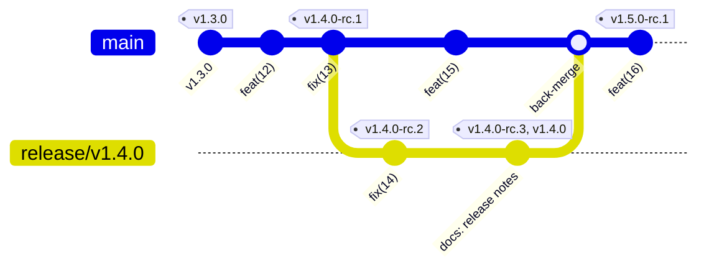
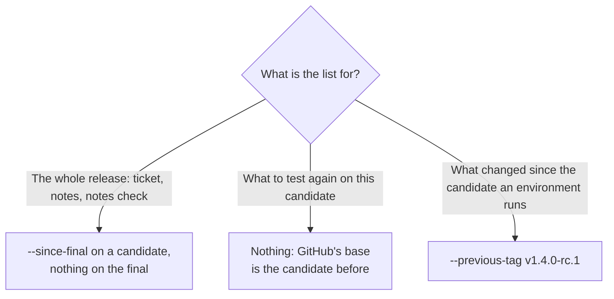

Where `gh release-changes` fits in a release with a release branch and release candidates: which command to run
at which moment, on which tag, and which range GitHub compares it with. The commands themselves are described in
[Commands](); this page puts them in order.

## The flow

Work is merged into `main`. A release is cut from `main` as a branch, `release/v1.4.0`, and tagged `v1.4.0-rc.1`.
Fixes for the release are merged into the release branch, and every round of fixes gets the next candidate,
`rc.2`, `rc.3`. The accepted candidate is tagged `v1.4.0`, and the release branch is merged back into `main`.



- `rc.1` is the commit the release branch starts from. `feat(15)`, merged into `main` while the release is under
  way, is not in `v1.4.0`: it is in `v1.5.0`.
- `fix(14)` was found while testing `rc.1`, and is merged into the release branch.
- The release notes are written on the release branch too, and checked before the final is tagged.
- The final is tagged on the commit of the accepted candidate, so what was tested is what is released.
- The back-merge brings the fixes and the notes into `main` before the next release branch is cut.

## The range of every tag

Every command compares the tag with a base. Without flags the base is GitHub's choice, and that choice already
follows the flow:

| Tag           | GitHub's base | Covers                                    | `--since-final` |
|---------------|---------------|-------------------------------------------|-----------------|
| `v1.4.0-rc.1` | `v1.3.0`      | The release as it was cut                 | `v1.3.0`        |
| `v1.4.0-rc.2` | `v1.4.0-rc.1` | Only what changed since `rc.1`: `fix(14)` | `v1.3.0`        |
| `v1.4.0-rc.3` | `v1.4.0-rc.2` | Only the release notes                    | `v1.3.0`        |
| `v1.4.0`      | `v1.3.0`      | The whole release                         | `v1.3.0`        |
| `v1.5.0-rc.1` | `v1.4.0`      | The next release, `feat(15)` included     | `v1.4.0`        |

So the question to ask is what a list is for:



- **The whole release.** A ticket, the notes and the notes check are about the release, not about one candidate.
  The final already covers it, but the final is tagged last. On a candidate `--since-final` gives the range the
  final will have. `ticket` uses it by default.
- **What changed since the last candidate.** GitHub's base for `rc.N` is `rc.N-1`, so a run without flags is the
  delta QA tests again.
- **Something else.** `--previous-tag` takes any tag: when `rc.2` was never deployed to acceptance, compare `rc.3`
  with `rc.1` to see what is new there.

## Step by step

The steps as commands. [From your laptop]() runs them by hand, with
the tag picker and the ticket prompt; [the guides]() move them into CI.

### 1. Cut the release: `rc.1`

```shell
git switch --create release/v1.4.0 origin/main
git tag --annotate v1.4.0-rc.1 --message "Release candidate v1.4.0-rc.1"
git push origin release/v1.4.0 v1.4.0-rc.1
```

Create the release ticket, after a look at what it would be:

```shell
gh release-changes --link closing ticket v1.4.0-rc.1 --dry-run
gh release-changes --link closing ticket v1.4.0-rc.1
```

```text
https://github.com/example-org/app/issues/120
```

The ticket lists every issue of the release, and the pull requests without one. Its template is the
repository's; start one with [`ticket init`](). To have this step happen on
every pushed tag, see [the release ticket from GitHub Actions]().

### 2. Test and fix: `rc.2`

QA tests `rc.1` and finds a bug; `fix(14)` is merged into the release branch, and `rc.2` is tagged on it.

Update the ticket. It is found by its label and the version in its title, and compared with the previous final
again, so it keeps the whole release rather than shrinking to `fix(14)`:

```shell
gh release-changes --link closing ticket v1.4.0-rc.2
```

What to test again is the delta, GitHub's own range:

```shell
gh release-changes --link closing issues v1.4.0-rc.2 --titles
```

```markdown
## Issues

### Bug fixes

* #14 The export stops at 1000 rows
```

Only the part of the ticket between its markers is rewritten, so the boxes QA ticked at `rc.1` stay ticked.

### 3. Write the notes, and check them

The notes are written for the whole release, from what the issues say. `dump` puts it in one document, for a
person or [an agent]() to write from:

```shell
gh release-changes --since-final --link closing dump v1.4.0-rc.2 > dump.md
```

Before the notes are merged, check them against the newest candidate, with the range of the final:

```shell
gh release-changes --since-final --link closing check-notes v1.4.0-rc.2 --file docs/release-notes/1.4.0.md
```

```markdown
## Notes check

### Issues missing from the notes

* #14
```

Exit code `2` means the notes and the release disagree: here the fix from step 2 is not in the notes yet. Fix
the notes and run it again until it exits `0`. The check can run on the notes pull request itself:
see [the notes check in CI]().

A change merged into the release branch after the newest candidate is not in the check: tag a candidate first.

### 4. Release: the final

The notes are merged and tagged `rc.3`, and `rc.3` is accepted. Tag the final on the same commit, and update the
ticket one last time:

```shell
git tag --annotate v1.4.0 --message "Release v1.4.0" "v1.4.0-rc.3^{commit}"
git push origin v1.4.0
gh release-changes --link closing ticket v1.4.0
```

GitHub compares the final with `v1.3.0`, so `sort` gives the whole release for the GitHub release:

```shell
gh release create v1.4.0 --verify-tag --title v1.4.0 --notes-file <(gh release-changes sort v1.4.0)
```

### 5. Merge back into `main`

Merge `release/v1.4.0` into `main` with a pull request. That pull request is a change of the next release, so it
shows up in `v1.5.0-rc.1`'s lists as Maintenance, and in `issues --unlinked`. Keep it out of every command by
labelling it, and excluding the label in the repository's `.github/release.yml`:

```yaml
changelog:
  exclude:
    labels:
      - back-merge
```

The pull requests merged into the release branch are reachable from `v1.4.0`, so the next release does not list
them again.

### Patch releases

A patch for `v1.4.0` is a fix on the release branch, tagged `v1.4.1-rc.1` and `v1.4.1`. GitHub compares it with
`v1.4.0`, and `--since-final` does too: the steps above apply as they are, with a ticket of its own for `1.4.1`.

## Closing references in the flow

`--link closing` also counts the issues a pull request closes, on top of the digit scopes of its title. A
`docs: …` pull request with `Closes #20` in its description brings `#20` into the release only with the flag.

Pass it to `ticket` and to `check-notes` both, or to neither:

| `ticket` | `check-notes` | `#20` in the ticket | `#20` to the notes check                       |
|----------|---------------|---------------------|------------------------------------------------|
| with     | with          | yes                 | In the release: the notes must mention it      |
| without  | without       | no                  | Outside the release: the notes must not        |
| with     | without       | yes                 | Outside the release, though the ticket has it  |
| without  | with          | no                  | In the release, though the ticket does not say |

The first row is the one to aim for: QA tests what the ticket lists, and the notes describe exactly that. Pass
it to `dump` as well, so the notes are written from the same issues they are checked against.
